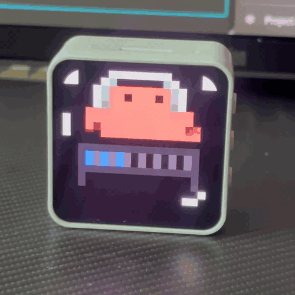
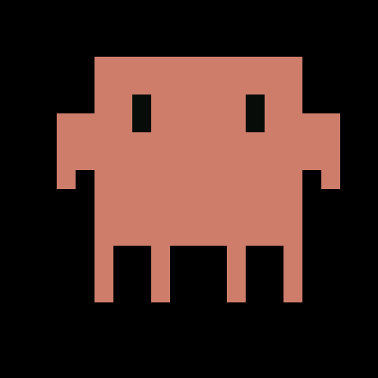
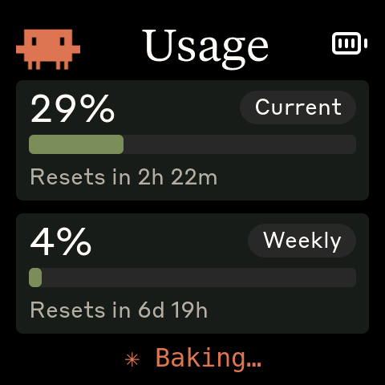

# Clawdmeter

A small ESP32 dashboard I made for my desk to keep an eye on Claude Code usage.

It runs on a [Waveshare ESP32-S3-Touch-AMOLED-2.16](https://www.waveshare.com/esp32-s3-touch-amoled-2.16.htm?&aff_id=149786) as well as a few other alternative boards. **It's fully standalone** — it joins your WiFi, holds its own Claude login, and polls Anthropic directly; there's no host daemon and no Mac/PC required after setup. The splash screen plays pixel-art Clawd animations that get busier when your usage rate climbs.

|              Usage meter              |              Clawd animation screen              |
| :-----------------------------------: | :----------------------------------------------: |
|  |  |

The Clawd animations come from [claudepix](https://claudepix.vercel.app), [@amaanbuilds](https://x.com/amaanbuilds)'s library of pixel-art Clawd sprites, check it out, it's lovely.

## Screens

The device boots into the splash. Tap the screen anywhere to switch to the Usage view; tap again to flip back to the splash.

|              Splash               |              Usage              |
| :-------------------------------: | :-----------------------------: |
|  |  |
|   Splash; touch-toggle anytime    | Session and weekly utilization  |

While the splash is up, the middle (PWR) button cycles animations. **Hold the BOOT button for 3 seconds, then release, to wipe the saved WiFi credentials** — the device reboots into the WiFi setup captive portal so you can re-provision it (e.g. after moving it to a new network). The firmware also auto-rotates animations every 20 s within the current usage-rate group, so a long stretch on the splash isn't just one Clawd on loop.

## Hardware

Boards supported out of the box:

- [Waveshare ESP32-S3-Touch-AMOLED-2.16](https://www.waveshare.com/esp32-s3-touch-amoled-2.16.htm?&aff_id=149786)
- [Waveshare ESP32-C6-Touch-AMOLED-2.16](https://www.waveshare.com/esp32-c6-touch-amoled-2.16.htm?&aff_id=149786) 
- [Waveshare ESP32-S3-Touch-AMOLED-1.8](https://www.waveshare.com/esp32-s3-touch-amoled-1.8.htm?&aff_id=149786)
- [Waveshare ESP32-C6-Touch-AMOLED-1.8](https://www.waveshare.com/esp32-c6-touch-amoled-1.8.htm?&aff_id=149786)

> Please check if a pull request exists for your alternative hardware port before opening a new one, providing QA feedback and testing on the same hardware is more valuable than duplicate pull requests.

**Porting to another board:** the firmware is a thin HAL with per-board folders under `firmware/src/boards/`. Drop in a new folder and a new PlatformIO env — `main.cpp`, `ui.cpp`, and `splash.cpp` never need to change. See [`docs/porting/adding-a-board.md`](docs/porting/adding-a-board.md) for the walk-through and [`docs/porting/hal-contract.md`](docs/porting/hal-contract.md) for the interfaces a port must implement.

## Prerequisites

- Linux (tested on Ubuntu), macOS, or Windows 10/11 to *flash* the board
- [PlatformIO CLI](https://docs.platformio.org/en/latest/core/installation/index.html)
- A WiFi network (2.4 GHz) the board can join
- A phone, laptop, or any device with a browser, to do the one-time WiFi + Claude login setup
- A Claude subscription (Pro/Max) to log in with

That's it — **no daemon, no always-on Mac/PC, no Python/Node install, no Bluetooth pairing.** Once set up, the board runs entirely on its own; the computer you used to flash and set it up doesn't need to stay on or stay nearby.

## Setup

### 1. Flash the firmware

```bash
# macOS (auto-detects /dev/cu.usbmodem*)
./flash-mac.sh waveshare_amoled_216
./flash-mac.sh waveshare_amoled_18  /dev/cu.usbmodem1101  # or pass an explicit USB serial port

# Linux (defaults to /dev/ttyACM0)
./flash.sh waveshare_amoled_216
./flash.sh waveshare_amoled_18  /dev/ttyACM1              # or pass an explicit USB serial port

# Windows
pio run -d firmware -e waveshare_amoled_216 -t upload --upload-port COM5   # use your device's COM port
```

The board env name is required. Run `./flash.sh` / `./flash-mac.sh` with no args (or `pio run -d firmware` with no env) to see the available envs, scraped from `firmware/platformio.ini`.

### 2. Join WiFi

On first boot (or after a WiFi reset) the board opens an access point named **`Clawdmeter-Setup`** (open, no password). Join it from your phone or laptop — a captive portal should pop up automatically; if not, browse to any `http://` address and you'll be redirected. Pick your home network from the list, enter its password, and submit. The board reboots and joins your WiFi.

To re-run this later (new network, wrong password, etc.), **hold the BOOT button for 3 seconds and release** — this wipes the saved WiFi credentials and puts the board back into the `Clawdmeter-Setup` portal.

### 3. Log in to Claude

Once the board is on your WiFi, open **`http://clawdmeter.local`** in a browser on the same network. Click **"Log in to Claude"** — this opens Anthropic's OAuth consent page in a new tab. Approve access, copy the code Anthropic shows you, and paste it back into the board's page. The board exchanges it for a token, stores it on-device, and starts polling your usage immediately.

From here on the board is fully self-sufficient: it refreshes its own token and polls the Anthropic API every 60 seconds, with no host, daemon, or app required. `http://clawdmeter.local` remains available afterwards to check status or log out.

## Known limitations / risks

- The login flow rides on Anthropic's **undocumented** consumer OAuth endpoints (the same ones `claude.ai`'s own web login uses). They aren't a published/stable API and could change or be restricted without notice, which would break login until the firmware is updated.
- The board stores its **own** Claude refresh token in flash (NVS). It is a completely separate, independent login from any `claude` CLI/Claude Code session on your computer — logging the board in or out never touches your machine's credentials, and vice versa.
- Because the token lives on the device, treat physical access to the board like access to a logged-in browser tab: anyone with the board can see your usage, and (via the same "Log out" control) can log it out.

## How it works

1. On boot, the firmware connects to the WiFi network you provisioned it with (`net.cpp`), falling back to the `Clawdmeter-Setup` captive portal if it can't.
2. It advertises itself via mDNS as `clawdmeter.local` and serves a tiny status/login page over HTTP.
3. The one-time OAuth login (PKCE) gets an access + refresh token for the board's own Claude account, stored in on-device flash.
4. Every 60 seconds, the firmware calls `api.anthropic.com/v1/messages` directly — one token of Haiku, basically free — refreshing its token first if needed.
5. The usage numbers come straight out of the response headers (`anthropic-ratelimit-unified-5h-utilization` and friends) and go directly into the LVGL dashboard — no intermediate host or daemon involved.
6. The firmware also tracks the rate of change of session % over a 5-minute window and picks splash animations from the matching mood group.

## Physical buttons

| Button           | GPIO / source | Function                                                          |
| ---------------- | -------------- | ------------------------------------------------------------------ |
| **BOOT**         | GPIO 0 (GPIO 9 on the C6 1.8 board) | Hold ~3s + release: wipe saved WiFi credentials and re-open the `Clawdmeter-Setup` portal |
| **Middle** (PWR) | AXP2101 PKEY (or an IO-expander pin, board-dependent) | On splash: cycle animations. On the usage screen: cycle brightness |

The 2.16 board also has a right-side button (GPIO 18) that is currently unused — it drove a BLE HID shortcut in an earlier, Bluetooth-based version of this firmware, since removed.

## Recompiling fonts

The `firmware/src/font_*.c` files are pre-compiled LVGL bitmap fonts.

```bash
npm install -g lv_font_conv
```

Generate each one (one at a time — `lv_font_conv` doesn't like loop-driven invocations) with `--no-compress` (required for LVGL 9):

```bash
# Tiempos Text (titles, 56px)
lv_font_conv --font assets/TiemposText-400-Regular.otf -r 0x20-0x7E \
  --size 56 --format lvgl --bpp 4 --no-compress \
  -o firmware/src/font_tiempos_56.c --lv-include "lvgl.h"

# Styrene B (large numbers 48, panel labels 28, small text 24, minimal 20)
for size in 48 28 24 20; do
  lv_font_conv --font assets/StyreneB-Regular.otf -r 0x20-0x7E \
    --size $size --format lvgl --bpp 4 --no-compress \
    -o firmware/src/font_styrene_${size}.c --lv-include "lvgl.h"
done

# DejaVu Sans Mono (32px, with spinner Unicode chars)
lv_font_conv --font assets/DejaVuSansMono.ttf \
  -r 0x20-0x7E,0xB7,0x2026,0x2722,0x2733,0x2736,0x273B,0x273D \
  --size 32 --format lvgl --bpp 4 --no-compress \
  -o firmware/src/font_mono_32.c --lv-include "lvgl.h"
```

**Important:** `lv_font_conv` v1.5.3 outputs LVGL 8 format. Each generated file must be patched for LVGL 9 compatibility:

1. Remove `#if LVGL_VERSION_MAJOR >= 8` guards around `font_dsc` and the font struct
2. Remove the `.cache` field from `font_dsc`
3. Add `.release_glyph = NULL`, `.kerning = 0`, `.static_bitmap = 0` to the font struct
4. Add `.fallback = NULL`, `.user_data = NULL` to the font struct

Without these patches, fonts compile but render as invisible.

## Converting Lucide icons

The UI uses a small set of [Lucide](https://lucide.dev) icons (bluetooth + battery states) converted to RGB565 / RGB565A8 C arrays for LVGL.

```bash
node tools/png_to_lvgl.js assets/icon_bluetooth_48.png icon_bluetooth_data ICON_BLUETOOTH_WIDTH ICON_BLUETOOTH_HEIGHT
```

Default tint is white (`0xFFFFFF`); Lucide PNGs ship as black-on-transparent and would render invisible against the dark UI without it. Pass `--no-tint` for pre-coloured artwork like the logo. Battery icons use RGB565A8 (alpha plane) so they blend cleanly over the splash; the rest are baked RGB565 over the panel colour. Paste the converter output into `firmware/src/icons.h`.

## Splash animations

The animations come from [claudepix.vercel.app](https://claudepix.vercel.app),
a library of Clawd sprites. `tools/scrape_claudepix.js` evaluates the
site's JavaScript in a Node VM to pull out frame data and palettes, then
`tools/convert_to_c.js` turns everything into RGB565 C arrays and writes
`firmware/src/splash_animations.h`.

To re-pull (e.g. when the source library updates):

```bash
node tools/scrape_claudepix.js
node tools/convert_to_c.js
pio run -d firmware -t upload
```

See `tools/README.md` for details.

## Credits

- Pixel-art Clawd animation by [@amaanbuilds](https://x.com/amaanbuilds), sourced from [claudepix.vercel.app](https://claudepix.vercel.app). Frame data and palettes scraped + converted by the tooling in `tools/`.
- Lucide icon set ([lucide.dev](https://lucide.dev), MIT) for bluetooth and battery UI glyphs.
- Anthropic brand fonts (Tiempos Text, Styrene B) — see licensing warning below.

## Licensing gray area warning

The software in this repository uses and adheres to the Anthropic brand guidelines and uses the same proprietary fonts that Anthropic has a license for but this software uses without permission as well as using assets from Anthropic such as the copyrighted Clawd mascot so even though the code in this repo is non-proprietary I will not license it myself under a copyleft license since this repo includes proprietary fonts and copyrighted assets. Please be aware of this if you fork or copy the code from this repo. **You have been warned!**
